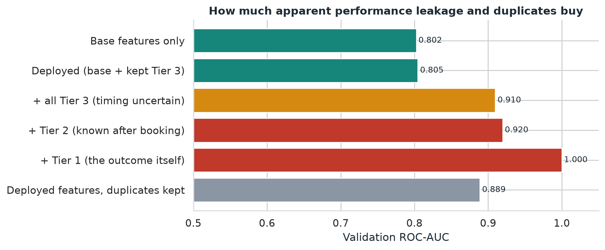
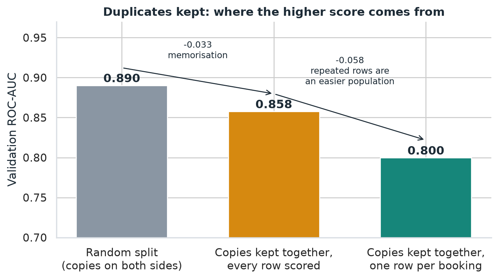

# Will this hotel booking be cancelled?

Predicting hotel booking cancellations **on the day the booking is made**, following the full machine
learning process: problem definition, data collection, exploration and cleaning, a leakage audit, feature
engineering, model selection, three hyperparameter-search strategies, calibration, a cost-based decision
threshold, a final test, ONNX export, a FastAPI service on Vercel, and monitoring.

Machine Learning Assignment 1, classification problem.

**Demo and API:** _not deployed yet_ (interactive API documentation at `/docs`)

| Deliverable | Where |
|---|---|
| Code: the executed notebook | [notebooks/01_hotel_cancellation_classification.ipynb](notebooks/01_hotel_cancellation_classification.ipynb) |
| Process documentation | [docs/PROCESS.md](docs/PROCESS.md) (Word and PDF copies in `docs/`) |
| Deployed endpoint | _not deployed yet_ |
| Model card, architecture | [docs/MODEL_CARD.md](docs/MODEL_CARD.md), [docs/ARCHITECTURE.md](docs/ARCHITECTURE.md) |

## Results

All numbers below are generated from `reports/metrics/pipeline/metrics.json`.

| | |
|---|---|
| Data | 119,390 bookings from two Portuguese hotels, 2015 to 2017; 87,228 after cleaning |
| Split | 61,058 train / 13,085 validation / 13,085 test (stratified) |
| Champion | LightGBM, tuned by Bayesian search on all training rows |
| **Test ROC-AUC** | **0.807** (95% CI 0.799 to 0.814) |
| Test PR-AUC | 0.636 (95% CI 0.620 to 0.651) |
| Baselines (test ROC-AUC) | logistic regression 0.774, majority class 0.500 |
| Cost-based threshold 0.63 | precision 0.812, recall 0.193, F1 0.311 |
| Best-F1 threshold 0.29 | precision 0.507, recall 0.746, F1 0.604 |
| Weekly cancellations per hotel, forecast error | 15% with the model, 25% without |
| Success criterion (test ROC-AUC of at least 0.85) | not met; beats both baselines: yes |

The test set was scored twice; [docs/PROCESS.md](docs/PROCESS.md) section 8.1 says what changed and shows
both results (first evaluation: 0.797).

## The finding that matters most: leakage

The dataset is a snapshot taken after the outcome was known, not at booking time, so several columns
contain values recorded later (often at check-in). A model that uses them looks excellent in testing and
fails in practice. Validation ROC-AUC as suspect columns are added back:

| Features | Validation ROC-AUC |
|---|---|
| Known at booking (deployed) | 0.805 |
| + timing-uncertain columns (parking, special requests, country) | 0.910 |
| + columns known only after booking (assigned room, changes, waiting list) | 0.920 |
| + the outcome itself (reservation status) | 1.000 |



**Duplicates.** 31,994 rows (26.8%) are exact duplicates. Kept and split at random, they lift
validation ROC-AUC to 0.890, but only 0.033 of that is memorisation: with copies
forced onto one side of the split the score is still 0.858, because 39% of the repeated
rows carry a non-refundable deposit, and such bookings are cancelled 99.6% of the time, which one
column predicts almost perfectly. Counting each distinct record once gives 0.800. The project reports the stricter number. The success criterion was fixed before
modelling and was not moved after seeing the result; [docs/PROCESS.md](docs/PROCESS.md) explains why it
was missed.



## Two ways to run it

**1. The notebook** (the code submission). `notebooks/01_hotel_cancellation_classification.ipynb` is
self-contained: upload it alone to Colab or Jupyter and run all cells. It installs missing packages,
downloads the data (checksum-verified) and defines every function it uses. Set the environment
variable `ML_FAST=1` for a smoke run of a few minutes. The saved outputs come from a full run with the
pinned versions in `pyproject.toml`. The notebook was also run alone in an empty folder, and (in fast
mode) with an older stack of the kind Colab ships: numpy 2.0.2, pandas 2.2.2, scikit-learn 1.6.1. It has
not been run on Colab itself; with other versions the numbers can differ slightly from the saved ones.

**2. The pipeline** (the same work as a tested Python package). Python 3.11 or newer:

```bash
python -m venv .venv && source .venv/bin/activate    # Windows: .venv\Scripts\activate
python -m pip install -e ".[dev]"                    # exact pinned versions
hotel-cancellation all                               # every stage, full budgets
python scripts/sync_service.py                       # copy feature code and model into service/
python scripts/build_notebooks.py                    # build and execute the notebook, full budgets
python -m pytest -q                                  # all tests
```

With `make` installed the same steps are `make setup pipeline sync-service notebooks test` (or
`make all`). `hotel-cancellation all --fast` and `python scripts/build_notebooks.py --fast` are smoke runs
with tiny budgets, never used for reported results. Any single stage can be run alone, for example
`hotel-cancellation tune`.

After a change that touches only the notebook's text (not its code), `python scripts/build_notebooks.py
--reuse-outputs` rebuilds it and keeps the saved outputs; it refuses if a code cell changed.

Stages, in order: `download`, `validate`, `clean`, `split`, `eda`, `leakage-audit`, `train`, `tune`, `select`,
`diagnose`, `evaluate`, `explain`, `export`, `report`. Each reads its inputs from disk and writes its outputs, so any stage can be
re-run alone. Every run writes a manifest (git commit, config, package versions) to `artifacts/runs/`.

The notebook and the pipeline run **the same code**: `scripts/build_notebooks.py` copies the package's
functions verbatim into the notebook, and `tests/parity/test_notebook_vs_pipeline.py` checks that both use
the same split (by a fingerprint of the test rows) and reach the same test metrics.

## Deployment (Vercel)

The API lives in `service/`, which is all that ships: FastAPI, numpy and onnxruntime, plus a
6,511 KB ONNX model. It does not import the training package.

```bash
cd service
npx vercel login          # once
npx vercel --prod         # deploys this folder; prints the URL
```

Then put the URL in `configs/config.yaml` (`service.url`) and measure it:

```bash
hotel-cancellation monitor drift
hotel-cancellation monitor latency --url https://<your-app>.vercel.app
python scripts/check_live.py https://<your-app>.vercel.app
```

| Endpoint | Purpose |
|---|---|
| `GET /` | Demo page |
| `GET /docs` | Interactive API documentation |
| `GET /health` | Liveness and model version |
| `GET /api/v1/model` | Model card: features, threshold, test metrics, excluded columns |
| `POST /api/v1/predict` | One booking in, cancellation probability, decision and risk band out |
| `POST /api/v1/predict/batch` | Up to 100 bookings |
| `POST /api/v1/feedback` | Report the real outcome of an earlier prediction |
| `GET /api/v1/feedback/summary` | How predictions compare with the outcomes reported so far |
| `GET /api/v1/metrics` | Request counts and latency for the serving instance |

```bash
curl -X POST https://<your-app>.vercel.app/api/v1/predict -H "Content-Type: application/json" -d '{
  "hotel": "City Hotel", "lead_time": 120, "arrival_date": "2026-08-14",
  "stays_in_weekend_nights": 1, "stays_in_week_nights": 3, "adults": 2, "children": 0, "babies": 0,
  "meal": "BB", "market_segment": "Online TA", "distribution_channel": "TA/TO", "is_repeated_guest": false,
  "previous_cancellations": 0, "previous_bookings_not_canceled": 0, "reserved_room_type": "A",
  "deposit_type": "No Deposit", "agent": 9, "company": null, "customer_type": "Transient", "adr": 115.0}'
```

Locally: `python scripts/sync_service.py`, then `cd service && uvicorn main:app --port 8000` and open
http://127.0.0.1:8000.

**Monitoring.** 300 real validation bookings were replayed one at a time against a local copy of the service: the first request took 46 ms, then the median was 22 ms, the 95th percentile 35 ms and the 99th 37 ms, measured from the client; the error rate was 0.0%. The server's own processing time had a median of 3.9 ms; the rest is network and platform overhead.

## Repository map

```
configs/config.yaml        every tunable setting (data, leakage decisions, costs, budgets, success criteria)
notebooks/                 the self-contained notebook (built from notebooks/_src by scripts/build_notebooks.py)
src/hotel_cancellation/    the package: one module per concern, cli.py for the command line
scripts/                   notebook builder, standalone check, service sync, live check, bundle size
service/                   the deployed API (Vercel root directory)
tests/                     unit, integration (pipeline, API) and parity tests
reports/figures/           every chart, 200 dpi
reports/metrics/           pipeline/ and notebook/ results (the only source of numbers in the docs);
                           history/ holds the archived first test evaluation
docs/                      PROCESS.md (+ .docx, .pdf), ARCHITECTURE.md, MODEL_CARD.md
data/mirror/               compressed copy of the raw data (fallback source)
```

## Tests and consistency checks

`python -m pytest -m "not slow" -q` runs unit tests (cleaning rules, features, splits, metrics, the
analyses, configuration), API tests (valid and invalid input, unknown categories, batch, feedback) and
parity checks: the service's feature code is identical to the package's, the service's model files are
identical to the export, and the service reproduces the pipeline's predictions within 1e-4 on 200
held-out bookings (measured: 1.3e-07). `python -m pytest -q` adds an end-to-end pipeline run in fast
mode; `python scripts/check_standalone.py` proves the notebook runs alone in an empty folder.

## Data and citation

Antonio, N., de Almeida, A., and Nunes, L. (2019). Hotel booking demand datasets. *Data in Brief*, 22,
41-49. https://doi.org/10.1016/j.dib.2018.11.126. Licensed CC BY 4.0. Retrieved from the TidyTuesday
project (2020-02-11); a compressed copy is in `data/mirror/`. The code in this repository is under the MIT
licence (see `LICENSE`).
