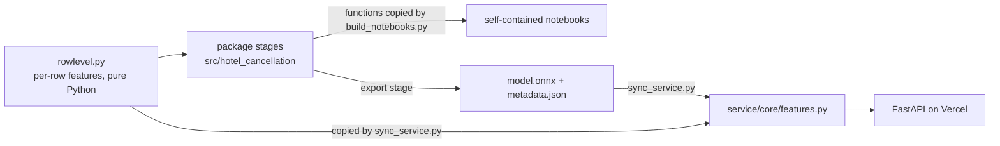
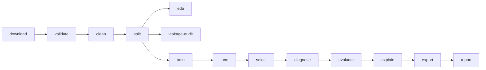

# Architecture

## Three consumers, one source of truth

- **The package** (`src/hotel_cancellation/`) is where code is written and tested.
- **The notebooks** are built from `notebooks/_src/*.py` (jupytext). Cells marked `# @inline module: names`
  are replaced with the package's source for those definitions, and `# @inline imports` with every
  third-party import they need. The result runs on its own, with no imports from the repository. For this
  to work, package modules import siblings by name (`from .plotting import finish_figure`) and every
  top-level name is unique across the package; the builder fails if two modules define the same name.
- **The service** (`service/`) never imports the package. It gets a generated copy of `rowlevel.py` and the
  exported model files.

## Pipeline stages

| Stage | Writes |
|---|---|
| download, validate | `data/raw/` (checksum-verified), `data_audit.json`, `quality_audit.json` (inconsistencies, outliers) |
| clean, split | `data/interim/clean.pkl`, `cleaning.json`, `data/processed/splits.json`, `split.json` |
| eda, leakage-audit | figures, `eda.json` (summary tables), `leakage.json` (tier evidence, ablation, duplicate decomposition) |
| train | `candidates.json`, `experiments.json` (encoding, imbalance, extra features) |
| tune | `tuning.json`: stage 1 (grid, random, Bayesian on a subsample) and stage 2 (Bayesian on all training rows) |
| select | `champion.json`, `artifacts/test_models.joblib` |
| diagnose | `diagnostics.json` (calibration, threshold, operating points, cost sensitivity, risk groups, weekly counts, curves; all on validation), `temporal.json` |
| evaluate | `test.json` (the only stage that reads the test set; same analyses, thresholds from validation) |
| explain, export | `explain.json`, `artifacts/export/`, `deployment.json` |
| report | `metrics.json`, the single results file |

Results go to `reports/metrics/pipeline/`; each run also writes a manifest (git commit, configuration,
package versions, timing) to `artifacts/runs/`. Three commands run outside the stage list, once the
service is up: `hotel-cancellation monitor drift` (`drift.json`), `hotel-cancellation monitor latency --url ...`
(`monitoring.json`) and `python scripts/check_live.py <url>` (`live_check.json`).

The test set has been scored twice. The first evaluation is archived in `reports/metrics/history/` and
recorded in `configs/config.yaml` (`first_test_evaluation`); a unit test checks that the two agree, and
the notebook and the process document show both results.

## Module map

| Module | Responsibility |
|---|---|
| `config.py` | Typed configuration; rejects missing or unknown keys |
| `artifacts.py` | Run folders, JSON helpers, manifests |
| `data.py`, `validation.py` | Download with checksum, time limit and fallbacks; schema checks; data-quality audit |
| `cleaning.py` | Fixed, logged cleaning rules |
| `rowlevel.py`, `features.py` | Per-row features; fitted encoders inside the model pipeline |
| `split.py` | Stratified and temporal splits, test-row fingerprint |
| `models.py` | Candidate models with their preprocessing |
| `leakage.py`, `robustness.py` | Tiered leakage ablation; duplicate decomposition and temporal checks |
| `tuning.py` | Grid, random and Bayesian search behind one interface; second-stage refinement on all training rows |
| `evaluation.py`, `experiments.py` | Metrics, bootstrap CIs, calibration, thresholds, operating points, cost sensitivity, risk groups, weekly-count forecast, curves; design experiments |
| `workflow.py` | Steps shared by pipeline and notebook, including the single test pass |
| `explain.py`, `export.py` | Permutation importance and SHAP; ONNX export and metadata |
| `plotting.py` | Every figure, one style |
| `monitoring/` | Live latency replay; PSI and KS drift |
| `pipeline.py`, `cli.py` | Disk-backed stages and the command line |

## Service

`service/main.py` loads `models/model.onnx` and `models/metadata.json` once at start-up. A request is
validated by Pydantic (`core/schemas.py`), converted to the dataset's raw column names, passed through the
shared feature code, encoded with the exported category codes (unseen categories get the unknown code and
are reported back), scored by ONNX Runtime, calibrated by interpolation and compared with the threshold.
Middleware adds an `X-Process-Time-ms` header, logs one JSON line per request, refuses bodies above 1 MB
and turns any crash into a JSON error; every error has the same shape (`error`, `message`, `errors`, `hint`).
Runtime dependencies are FastAPI, numpy and onnxruntime only; `python scripts/bundle_size.py` measures the bundle.

**Feedback.** `POST /api/v1/feedback` stores the prediction ID, the real outcome and the prediction that was
made (never the booking itself). With the environment variables of an Upstash Redis database
(`UPSTASH_REDIS_REST_URL` and `UPSTASH_REDIS_REST_TOKEN`, or Vercel's `KV_REST_API_URL` and
`KV_REST_API_TOKEN`) records go to one capped Redis list through its REST interface; without them, or when
Redis cannot be reached, they are kept in the instance's memory. `GET /api/v1/feedback/summary` turns the
records into live calibration and accuracy figures, and `/health` says which storage is in use.

## Documents

The numbers in `README.md`, `docs/PROCESS.md` and `docs/MODEL_CARD.md` are filled in from the results files
in `reports/metrics/`, together with `docs/author.json` and the service URL in the configuration, so the
documents cannot quote a figure the pipeline did not produce. `docs/PROCESS.docx` and `docs/PROCESS.pdf` are
copies of `docs/PROCESS.md`. The slide deck reads the same results files.

## Consistency checks

| Risk | Check |
|---|---|
| Notebook and pipeline disagree | `test_notebook_vs_pipeline.py`: identical cleaning counts, split sizes and test-row fingerprint, then test metrics within 0.005 |
| Service features differ from training | `test_service_sync.py`: `service/core/features.py` equals `rowlevel.py` |
| Service model is stale | `test_service_sync.py`: model files equal the export, byte for byte |
| Service predicts differently | `test_service_parity.py`: 200 held-out bookings through the API schema, within 1e-4 |
| Notebook secretly depends on the repo | `check_standalone.py`: the notebook runs alone in an empty folder |
| Deployed service differs from the tested one | `check_live.py`: same model fingerprint, 100 real bookings within 1e-4, bad input rejected cleanly |
| Recorded first test evaluation is misquoted | `test_analyses.py`: configuration values equal the archived results file |
