# Will this hotel booking be cancelled?

**Process documentation: Machine Learning Assignment 1 (The ML Process), classification problem**

**Author:** Abel Mari Shiferaw  
**Student ID:** GSR/1670/19  
**Course:** Machine Learning  
**Instructor:** Dr Fantahun Bogale Gereme  
**Institution:** Addis Ababa University, College of Technology and Built Environment  
**Date:** 22 November 2026

Demo and API: [https://hotel-cancellation-risk.vercel.app](https://hotel-cancellation-risk.vercel.app)

Code submission: `1_Code_Notebook.ipynb` in the submission folder (in the repository:
`notebooks/01_hotel_cancellation_classification.ipynb`)

---

## Summary

**Problem.** Predict, on the day a hotel booking is made, whether it will be cancelled, so that a revenue
manager can overbook safely and act on risky bookings. Supervised binary classification on 119,390
real bookings from two Portuguese hotels (Antonio, de Almeida and Nunes, 2019; CC BY 4.0).

**Result.**

| | |
|---|---|
| Data after cleaning | 87,228 bookings; 61,058 training / 13,085 validation / 13,085 test |
| Final model | LightGBM (gradient-boosted trees), tuned in two stages, 30 booking-time features |
| **Test ROC-AUC** | **0.807** (95% CI 0.799 to 0.814); target set in advance: 0.85 |
| Baselines, test ROC-AUC | tuned logistic regression 0.774; majority class 0.500 |
| Test PR-AUC / Brier score | 0.636 / 0.1487 |
| At the cost-based threshold (0.63) | precision 0.812, recall 0.193, F1 0.311, accuracy 0.766 |
| At the best-F1 threshold (0.29) | precision 0.507, recall 0.746, F1 0.604, accuracy 0.731 |
| Forecast of weekly cancellations per hotel | error 15% with the model, 25% without |
| Deployment | FastAPI service for Vercel, ONNX model of 6,511 KB; deployed; median response 520 ms over 300 replayed requests |
| Success criterion | **not met**; beats both baselines: yes |

**The three findings that matter.**

1. **In this work, scores above 0.85 are reached only with columns recorded after booking.** The file
   is a snapshot taken after the outcome was known. With the columns that are only recorded after booking,
   validation ROC-AUC is 0.920; with only what is known on the day of booking it is
   0.805. One column
   (parking spaces) has a cancellation rate of exactly zero whenever it is non-zero, because it is filled
   in at check-in.
2. **Duplicates inflate the score for two different reasons, and only one of them is memorisation.**
   Kept and split at random, duplicates lift ROC-AUC to 0.890. Forcing copies onto one side of the
   split still gives 0.858: 39% of the repeated rows carry a non-refundable deposit,
   and such bookings are cancelled 99.6% of the time, which one column predicts almost perfectly.
   Counting each distinct record once gives 0.800.
3. **The target of 0.85 was missed, and the evidence says it cannot be reached honestly with these
   columns.** Four model families land within 0.012 of each other, eight more engineered
   features add +0.0017, and two stages of hyperparameter search add +0.0051 on validation.
   The limit is the information available at booking time. The criterion was not moved.

**What the model is good for.** It ranks bookings usefully (the riskiest tenth cancels 74% of the
time, the safest tenth 3%) and its probabilities add up to an accurate forecast of how many
bookings will cancel in a week. Used to flag single bookings at a 2:1 cost ratio, it saves little
(10.3% against acting on nobody), and that is reported plainly.

**Where things are.** The executed notebook is the code submission and contains every step with its
output. This document explains the same steps for a reader without the code open. Section 11 lists every
deliverable and how to reproduce the results.

---

## How to read this document

Sections follow the assignment's numbering (which skips 7 and 9). Each section says **what was done**,
**why**, **what the alternatives were** and **what the result was**.

**Where the numbers come from.** The results in this document (data counts, model metrics, run times,
latency) are filled in by a script from the results files of the pipeline run; they are not typed. The
notebook runs the same code on the same split, and an automated test checks that both runs used the same
test rows and reached the same test metrics, so data counts and model metrics are the same in the two.
Two kinds of number were measured separately in each run and therefore differ between this document and
the notebook's saved output: run times in seconds (Sections 5 and 6.1) and the latency of the live
service (Section 10). This is said again next to those numbers.

Three kinds of data are kept apart throughout:

- **Training rows** fit models and feed cross-validation.
- **Validation rows** choose between models and set the calibration and thresholds.
- **Test rows** are used only for the final evaluation in Section 8. They have been scored twice; Section
  8.1 says exactly why and what changed.

The assignment's bullets and where each is addressed:

| Assignment bullet | Section here | Notebook section |
|---|---|---|
| Define the problem, the goal and the success criteria | 1 | 1 |
| Gather data; ensure it represents the domain | 2 | 2 |
| EDA: distributions, relationships, trends, charts | 3.2 | 3.5 |
| Cleaning: missing values, duplicates, outliers, inconsistencies | 3.3 | 3.1, 3.2 |
| Feature engineering: new features, encoding, scaling | 3.4 | 3.4 |
| Split into training, validation and test | 3.5 | 3.3 |
| Choose the model type; complexity, interpretability, cost | 4 | 4 |
| Design, create and train the model | 5 | 5 |
| Validation metrics: accuracy, precision, recall, F1, ROC-AUC | 5, 6.3 | 5, 6.3 |
| Underfitting and overfitting | 6.2 | 6.2 |
| Grid search, random search, Bayesian optimisation | 6.1 | 6.1 |
| Test-set evaluation with the same metrics | 8.1 | 8.1 |
| Deploy (FastAPI), integrate, free cloud platform | 8.2 | 8.2, 8.3 |
| Monitor performance and latency; drift; retraining; feedback | 10 | 10 |
| Document all steps; report; presentation | 11 | 11 |

---

## 1. Problem definition

**The business problem.** A hotel loses revenue when a booking is cancelled too late to resell the room.
Revenue managers protect against this by overbooking, but overbooking blind is risky: if more guests
arrive than there are rooms, someone has to be relocated to another hotel at the hotel's expense. A
reliable estimate of each booking's cancellation risk lets the hotel overbook where it is safe and, for
risky bookings, ask for a deposit or a confirmation.

**The goal.** Supervised binary classification of `is_canceled` (1 = cancelled, 0 = the guest arrived).

**The decision that shapes everything else: the prediction is made on the day of booking.** Only
information that exists at that moment may be used as a feature. I fixed this first because it is what
makes the model usable, and it is what later turns out to separate an honest score from an inflated one.

**How the prediction is used.** In two ways, which need different things from the model:

- *One booking at a time:* flag a booking and act on it. This needs a threshold, and the right threshold
  depends on what a wrong flag costs.
- *Many bookings together:* add the probabilities of all bookings for a hotel and a week to get the
  expected number of cancellations, from which an overbooking level is set. This needs calibrated
  probabilities, not a threshold.

**Costs.** A missed cancellation (false negative) leaves a room empty: 1 room-night. A false alarm (false
positive) leads the hotel to overbook a guest who then arrives and must be relocated: 2 room-nights. These
figures are assumptions, written into the configuration before modelling. They set the decision threshold
and nothing else; Section 6.3 shows how the decision changes if they change.

**Success criteria, fixed before modelling.**

1. Test ROC-AUC of at least **0.85**. ROC-AUC measures how well the model ranks cancelled bookings
   above kept ones, independent of any threshold and of the cost assumptions, which is why it is the main
   criterion rather than accuracy (a model that predicts "never cancelled" is already 72.5% accurate).
2. Better than two baselines on the test set: a majority-class model and a tuned logistic regression.
3. Calibrated probabilities, with the other classification metrics (accuracy, precision, recall, F1,
   PR-AUC, Brier score) reported with confidence intervals.

**Where the target came from.** I took 0.85 from the scores commonly reported for this dataset, which are roughly 0.85 to 0.95, before I knew that those results use columns recorded after booking. The leakage audit (Section 3.6) shows that this is where most of that performance comes from, so the target turned out to be a benchmark for an easier problem than the one defined here.

| Decision | Alternatives considered | Why this one |
|---|---|---|
| Predict at booking time | Predict a few days before arrival | Booking time is when overbooking and deposit decisions are made; a later prediction could use more columns but arrives too late to act on |
| ROC-AUC as the main criterion | Accuracy, F1 | Accuracy is dominated by the majority class; F1 depends on a threshold, and the threshold depends on costs the hotel may change |
| Threshold from stated costs | The default 0.5; the F1-optimal threshold | A threshold should follow from what errors cost; the other two are reported for comparison |

---

## 2. Data collection

**Source.** *Hotel booking demand datasets*: Antonio, N., de Almeida, A. and Nunes, L. (2019), Data in
Brief 22, 41-49, https://doi.org/10.1016/j.dib.2018.11.126. Open access under the **Creative Commons
Attribution 4.0 (CC BY 4.0)** licence, which permits use and adaptation with attribution. I used the
combined file distributed by the TidyTuesday project (2020-02-11): 119,390 bookings, 32 columns.

**Why a public dataset.** The assignment allows it, and this one is real operational data rather than a
teaching set: it comes from the property management systems of two hotels and has the problems real data
has (duplicates, impossible values, high-cardinality categories, class imbalance and, as it turned out,
leakage).

**Does it represent the problem domain?** Directly, with limits that I state rather than hide:

- One row per booking, with what was booked, how, at what price, and whether it was cancelled: exactly
  what a revenue manager sees.
- Two hotels in Portugal (a city hotel in Lisbon and a resort in the Algarve), arrivals from July 2015 to
  August 2017. Results may not transfer to other countries, hotel types or years.
- It is a snapshot extracted after the outcomes were known, so some columns hold values recorded after
  the booking was made (Section 3.6).
- It has no booking ID and no guest ID, so repeated rows cannot be told apart from repeated bookings
  (Section 3.7).

**Collection is reproducible.** The download uses a URL pinned to the exact commit that added the file,
with a second URL and a compressed copy in the repository as fallbacks. Whatever the source, the SHA-256
checksum of the file must match the recorded one, so every run analyses exactly the same bytes. A
whole-download time limit makes a slow connection fall through to the next source instead of hanging.

---

## 3. Data exploration and preparation

### 3.1 Order of work

The assignment lists exploration, cleaning, feature engineering and splitting. All four are done, in an
order chosen for one reason: **anything that looks at the target uses training and validation rows only.**
Structural checks and cleaning (which never look at the outcome) come first on all rows, then the split,
then feature engineering, and only then the analysis of how features relate to cancellation. The test
rows play no part in the exploration, the feature decisions, the choice of model or the thresholds. They
were scored twice, and one decision (to improve the tuning) was taken after the first score was known;
Section 8.1 sets that out.

Three descriptive figures are computed on every row, test rows included, because they describe the file
and not a model: the cancellation rate before deduplication (37.0%), the cancellation rate
of the removed duplicate rows (63.1%), and the score a pipeline would report if it kept the
duplicates and split at random (0.889, one bar in the ablation chart of Section 3.6, which
re-splits all 119,390 rows). No decision depends on any of the three.

### 3.2 Exploratory data analysis

**Distributions (one variable at a time).** The numeric columns are strongly right-skewed: in the raw
file lead time has a median of 69 days and a maximum of 737, and price per night a
median of 95 (the notebook's table in its Section 3.5 gives the same statistics for the
cleaned training and validation rows).
After deduplication 27.5% of bookings are cancelled, a moderate class imbalance
(37.0% before deduplication).

**Relationships (two variables).** Cancellation rates differ sharply between categories, and cancelled
bookings were made much further ahead.

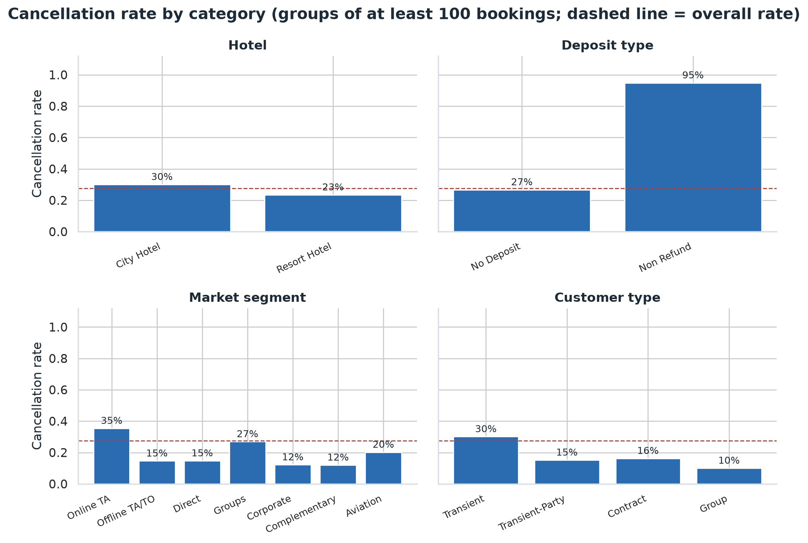

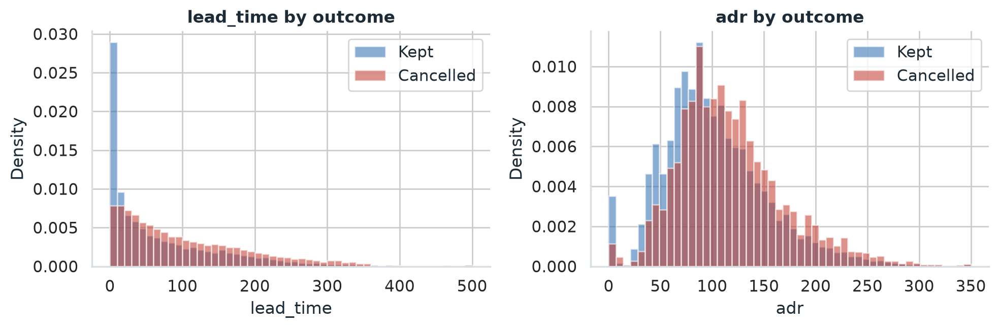

The "Non Refund" deposit type stands out: its bookings are cancelled almost always, the opposite of what a
non-refundable booking should do. The likely explanation is that these are block bookings by tour
operators that are released in bulk, so the label reflects a recording practice. The column is known at
booking time, so it stays, but I treated it as a warning that a high score on this data is not automatically
a good model. Section 3.7 shows how much of the score it accounts for.

**Trends.** The cancellation rate moves with the season and rises over the two years, a first sign that
the relationship drifts over time. Section 6.6 measures the effect and Section 10 turns it into a
retraining policy.

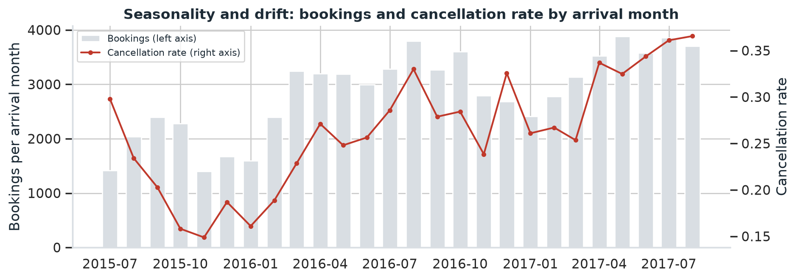

**Many variables together.** A correlation map shows the groups of related features; a PCA projection of
the numeric features (an unsupervised view) shows the two classes heavily overlapping, so no single
direction separates them and a non-linear model is likely to do better than a linear one.

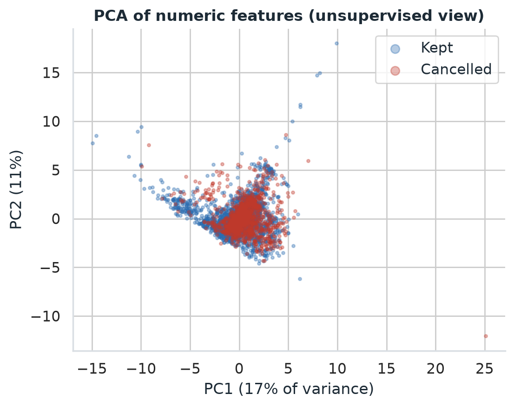

### 3.3 Data cleaning

Every cleaning rule is fixed and documented, and none is learned from the data, so cleaning can run before
the split without leaking anything.

**Missing values.** Four columns have missing values: `children` (4), `country` (488), `agent` (16,340), `company` (112,593). None of these is imputed with a statistic. A missing agent or
company means the booking had none, which is information: it becomes the feature "has a company" and the
agent code "none". A missing children count means zero. Missing country becomes its own category (country
is not a deployed feature). *Alternative considered:* mean or mode imputation, rejected because it would
erase exactly the signal that "no agent" carries.

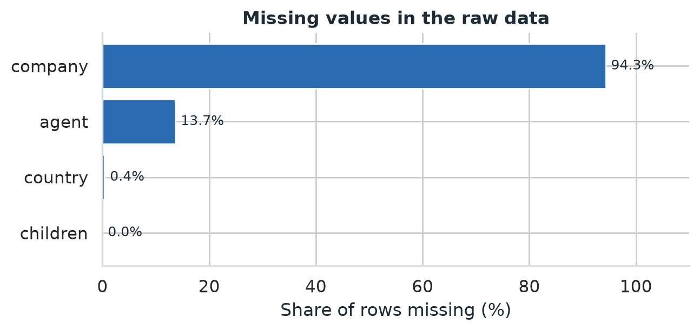

**Duplicates.** 31,994 rows (26.8%) are exact copies of another row, and they are removed
before splitting. Kept, copies of one row would land in both training and test and the model would be
graded partly on rows it had seen. The removed rows have a cancellation rate of 63.1%
against 27.5% in the cleaned data. There is no booking ID, so many of them are probably
genuine identical bookings; removing them is the cautious reading, and Section 3.7 measures what the
choice does. *Alternative considered:* keeping them with a grouped split; this is evaluated in Section 3.7.

**Inconsistencies.** Every logical check that was run, what it found, and what was done:

| Check | Rows | Share | Action | Why |
|---|---|---|---|---|
| Booking for zero guests | 180 | 0.15% | removed | A booking for nobody is a data-entry error. |
| Negative price per night | 1 | 0.00% | removed | Impossible. |
| Price above 1000 per night | 1 | 0.00% | removed | A single row, far above every other price in the data. |
| Meal code 'Undefined' | 1,169 | 0.98% | merged into SC | The dataset paper says both codes mean no meal package. |
| Children count missing | 4 | 0.00% | set to 0 | Missing means none. |
| Country missing | 488 | 0.41% | own category | Country is not a deployed feature; it is used only in the leakage audit. |
| Zero nights booked | 715 | 0.60% | kept | Day-use rooms and same-day departures exist in hotels. |
| Price of exactly 0 | 1,959 | 1.64% | kept | Complimentary stays and staff bookings are real. |
| No adults, only children or babies | 223 | 0.19% | kept | Usually an extra room attached to a family booking. |
| Market segment or channel 'Undefined' | 5 | 0.00% | kept | A handful of rows; the encoder groups rare categories together. |
| Not flagged as repeated guest, but has earlier bookings | 6,237 | 5.22% | kept | The two fields are recorded separately; the model sees both. |
| Flagged as repeated guest, but no earlier bookings | 590 | 0.49% | kept | Same reason. |

**Outliers.** The usual rule of thumb (values more than 1.5 interquartile ranges above the upper quartile)
flags thousands of rows in every skewed column, so applying it blindly would delete real bookings. I
judged each column on whether its extreme values are impossible or merely rare:

| Column | Median | 99th percentile | Maximum | Rows above the 1.5 IQR fence | Share | Decision |
|---|---|---|---|---|---|---|
| lead_time | 69 | 444 | 737 | 3,005 | 2.5% | kept: bookings a year or more ahead are real (groups, events); the model uses log(1 + lead time) |
| adr | 95 | 252 | 5,400 | 3,793 | 3.2% | kept up to 1000; the single value above it is removed |
| stays_in_week_nights | 2 | 10 | 50 | 3,354 | 2.8% | kept: long stays are real |
| stays_in_weekend_nights | 1 | 4 | 19 | 265 | 0.2% | kept: long stays are real |
| adults | 2 | 3 | 55 | 6,280 | 5.3% | kept: large parties are group bookings |
| children | 0 | 2 | 10 | 8,590 | 7.2% | kept |
| babies | 0 | 0 | 10 | 917 | 0.8% | kept |
| previous_cancellations | 0 | 1 | 26 | 6,484 | 5.4% | kept: a strong, legitimate signal |
| previous_bookings_not_canceled | 0 | 3 | 72 | 3,620 | 3.0% | kept: a strong, legitimate signal |

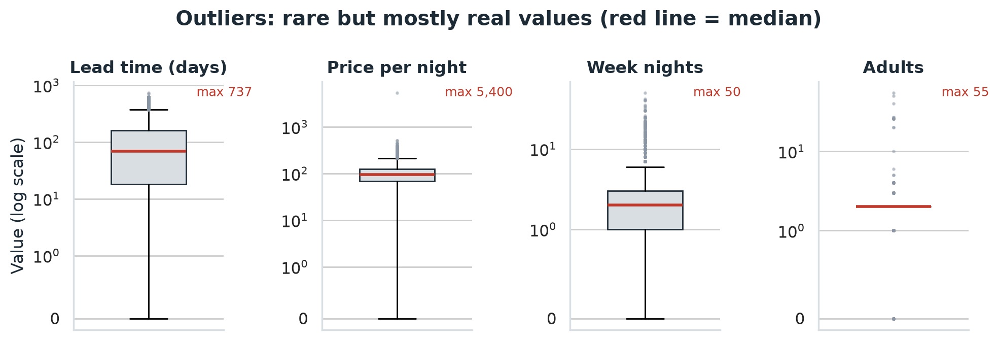

Only impossible values are removed. Long lead times, long stays and large parties are rare but real, and
they are exactly the bookings a hotel worries about. They are handled in the model instead: trees are
insensitive to how extreme a value is, and for the linear models lead time enters as a logarithm and every
numeric feature is standardised. *Alternatives considered:* deleting or capping (winsorising) outliers,
rejected because they would distort real bookings for no gain with tree models.

The cleaning log, rule by rule. The table of checks above counts rows in the raw file; the log counts what each rule removed or changed after the exact duplicates had been taken out, so its numbers are smaller (180 zero-guest bookings in the raw file, 166 once duplicates are gone).

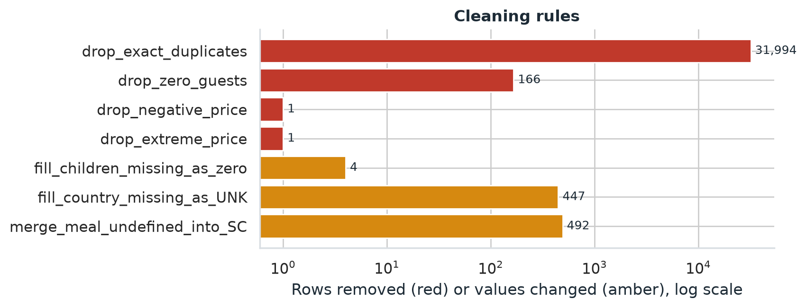

87,228 bookings remain.

### 3.4 Feature engineering

**One source of truth.** All per-row feature logic lives in one small pure-Python module. The training
code applies it to every row and the deployed API runs a copy of the same file, checked by a test, so the
features cannot differ between training and serving (a common cause of models that work offline and fail
in production).

**New features created from existing ones.**

| Feature | How it is made | Why |
|---|---|---|
| `log_lead_time` | log(1 + lead time) | Lead time is very skewed; the logarithm suits linear models |
| `arrival_week`, `arrival_weekday` | From the assembled arrival date | Weekly and weekday patterns |
| `month_sin`, `month_cos` | Cyclical encoding of the month | December and January are neighbours |
| `total_nights`, `weekend_share` | From the two stay columns | Length and type of stay |
| `total_guests`, `is_family` | From adults, children, babies | Party size and families |
| `has_booking_history`, `prior_cancel_ratio` | From previous cancellations and kept bookings | A guest's track record |
| `agent_id`, `has_company` | Missing means none | Who sold the booking |
| `adr_per_person` | Price over paying guests | Price relative to party size |

The deployed model uses 30 features: 8 categorical and 22 numeric.

**Encoding categorical variables.** Tree models receive integer codes (ordinal encoding). Categories seen
fewer than 30 times in training share one code, and categories never seen get their own "unknown" code,
which matters for a live service that will meet new travel agents. Linear models and the neural network
receive one-hot columns with the same grouping. *Alternatives tested* (Section 5): one-hot and target
encoding for the tree model.

**Scaling numeric features.** Linear models and the neural network get standardised features (mean 0,
standard deviation 1), which they need for the regularisation and the optimiser to treat features
equally. Tree models get the raw values, because a tree split depends only on the order of values and
scaling changes nothing.

**Where the encoders and scalers are fitted.** Inside the model pipeline, so they are refitted on the
training part of every cross-validation fold. Fitting them once on all rows would leak information from
the held-out fold into training.

### 3.5 Data splitting

A stratified random split: **70% training (61,058), 15% validation (13,085), 15% test
(13,085)**, with the same cancellation rate in each part. A fingerprint (hash) of the test rows is
recorded, and a test checks that the notebook and the pipeline used the same rows.

*Alternative considered:* a time-based split (train on earlier arrivals, test on later ones), which is
closer to how the model would be used. I kept the stratified split as the main one because with only two
years of data a time split would leave the test set covering eight months of a single year, and used the
time-based split as a robustness check instead (Section 6.6). That check shows a lower score, which is
reported as a limitation.

### 3.6 Leakage audit (beyond the brief)

The dataset is a snapshot taken after the outcome was known, so some columns contain values entered or
changed after the booking was made. A model that uses them looks excellent in testing and is useless in
practice, because on the day of booking those values do not exist yet. I sorted every column into a tier
by when its value becomes known:

| Tier | Columns | Treatment |
|---|---|---|
| 1. The outcome itself | reservation status and its date | Dropped |
| 2. Known only after booking | assigned room, booking changes, days on the waiting list | Excluded |
| 3. Timing uncertain | parking spaces, special requests, price, country | Decided on evidence |
| Never a feature | arrival year | A model cannot generalise to a year it has not seen |

**Evidence for the uncertain columns.** Bookings with a parking space are never cancelled in this data
(6,205 bookings, cancellation rate 0.0%). No real behaviour is that clean: parking
is recorded at check-in, so a non-zero value means the guest arrived. Special requests can be added at any
time before arrival, and guests who cancel stop adding them. For nationality the chart shows no value that gives the outcome away: bookings from the hotels' home country are cancelled 36% of the time, about the same as those with country code BRA (36%). What the data cannot establish is when the nationality is recorded, and on its own the column would add more than any other (+0.069), so it is excluded under the rule below. Price is agreed at
booking and its relationship with cancellation is smooth.

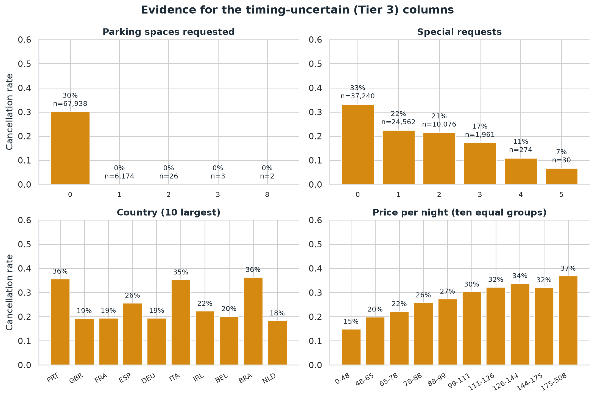

The rule for doubtful columns is **"when in doubt, exclude"**, and the cost of each exclusion is measured
(validation ROC-AUC each column would add on its own):

| Column | Decision | ROC-AUC it would add |
|---|---|---|
| adr | keep | +0.002 |
| required_car_parking_spaces | exclude | +0.025 |
| total_of_special_requests | exclude | +0.029 |
| country | exclude | +0.069 |

**How much the leakage is worth.** The same model, trained on training rows and scored on validation rows,
as each tier is added back:

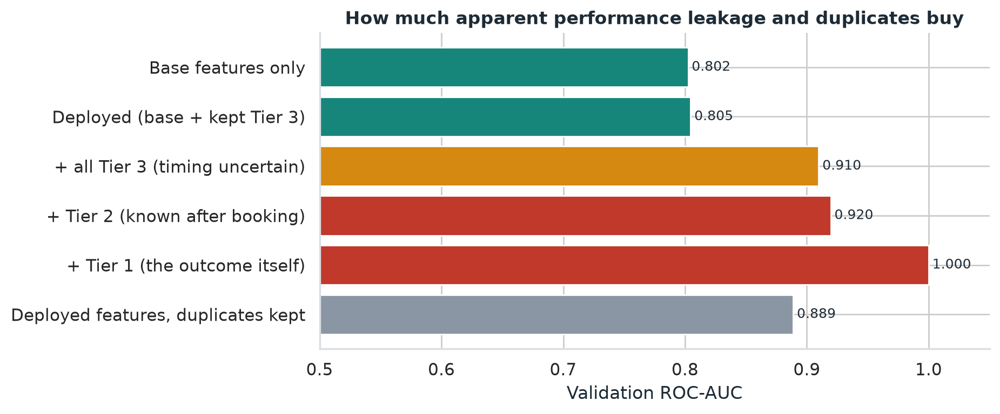

Validation ROC-AUC is 0.805 with the deployed features, 0.910 with the timing-uncertain
columns added, 0.920 with the post-booking columns and 1.000 with the outcome columns.
These four bars use training and validation rows only. The "duplicates kept" bar (0.889) is
the one exception: it re-splits every row of the raw file to show what a careless pipeline would report,
so rows that are test rows here take part in it. Nothing was chosen from that bar; Section 3.7 repeats
the comparison with the test bookings removed.

*Alternative considered:* keeping special requests, which many analyses of this dataset do and which would
add +0.029. I excluded it because I could not establish when it is recorded; a hotel that knows
its requests are captured at booking should add it back.

### 3.7 What the duplicates really do to the score (beyond the brief)

It is tempting to say that keeping duplicates inflates the score because the model memorises copies. I
tested that, on training and validation bookings only (every row sharing its booking-time inputs with a
test booking was removed first). With duplicates kept, the same model was scored three ways:

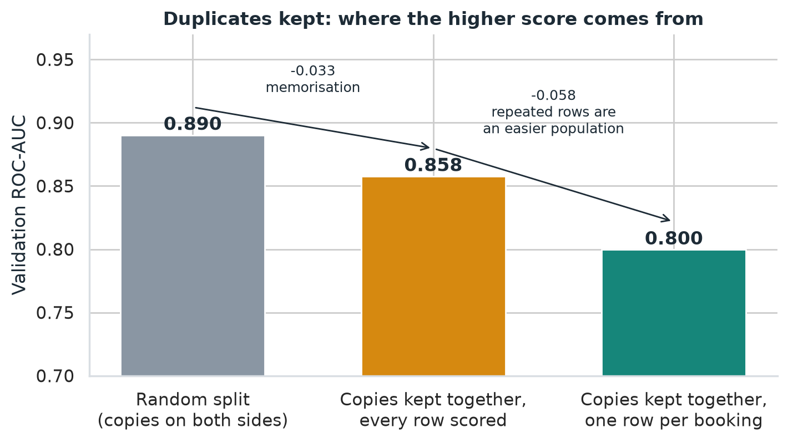

| Setup (duplicates kept) | Validation ROC-AUC |
|---|---|
| Random split: copies can sit on both sides | 0.890 |
| Copies forced onto one side, every row scored | 0.858 |
| Copies forced onto one side, one row per distinct record | 0.800 |
| Same, non-refundable bookings left out of the scoring | 0.795 |

- **Memorisation** accounts for 0.033 of the difference.
- The other 0.058 is a **different population**. 40% of the repeated rows are in
  the Groups market segment (against 3% of rows without copies) and
  39% carry a non-refundable deposit (against 0.3%). Non-refundable
  bookings are cancelled 99.6% of the time, so one column predicts them almost perfectly.

**What this means for the result.** The repeated rows look like block bookings, not copying errors,
although without a booking ID that cannot be proven. There are therefore two honest numbers that answer
different questions. Counting every row with no memorisation possible, a booking-time model reaches about
0.858, because roughly a tenth of the rows are trivially predictable blocks. On ordinary bookings,
where a prediction is actually needed, it reaches about 0.800 however the duplicates are handled. I
set the success criterion on the stricter reading (duplicates removed) before modelling, so that is the
number the project is judged on.

---

## 4. Algorithm selection

**Type of learning.** *Supervised*, because every booking has a known outcome, and *classification*,
because the outcome is one of two classes. *Unsupervised* methods (K-Means, PCA) have no target to learn
from; PCA is used for exploration only. *Reinforcement learning* does not fit: there is no sequence of
actions and rewards, only one prediction per booking.

**Candidates, from simplest to most flexible,** with the three considerations the assignment asks for:

| Model | Complexity | Interpretability | Computational cost | Why it is a candidate |
|---|---|---|---|---|
| Majority-class baseline | None | Total | None | The floor every model must beat |
| Logistic regression | Low | High: one coefficient per feature | Very low | A strong, honest linear baseline |
| Decision tree | Medium | High for a shallow tree | Low | Readable rules, but unstable |
| Random forest | High | Medium (importances) | Medium; very large model file | Robust non-linear reference |
| Histogram gradient boosting | High | Medium | Low | Fast boosting in scikit-learn |
| LightGBM | High | Medium, explained with SHAP | Low | Usually the strongest on tabular data |
| Small neural network | High | Low | Medium | Covers the neural-network family |

The measured cost of each (fit time, scoring time, size on disk) is in the table in Section 5.

**Not considered further.** Support vector machines and k-nearest neighbours scale poorly to 60,000 rows
with one-hot features and do not give calibrated probabilities. Deep networks have no advantage on a
table of 30 columns and would be harder to explain and to deploy.

**A constraint from deployment.** The API runs on a free serverless platform with a bundle-size limit, so
the deployed model must be small and convertible to ONNX. That favours gradient-boosted trees over a
random forest of similar accuracy, and it is written into the selection rule in Section 6.1.

---

## 5. Model development and training

**Design.** Each candidate is a scikit-learn pipeline of preprocessing (Section 3.4) and estimator, so
preprocessing is always fitted on training data only. All seeds are fixed.

**Training and first evaluation.** Each candidate is scored by cross-validation on a training subsample
(for stability) and then fitted on all training rows and scored on the validation set, with all of the
assignment's classification metrics (threshold metrics at the default 0.5):

| Model | CV ROC-AUC | ± std | Val. ROC-AUC | PR-AUC | Accuracy | Precision | Recall | F1 | Fit (s) | Score 1,000 rows (ms) | Size (KB) |
|---|---|---|---|---|---|---|---|---|---|---|---|
| lgbm | 0.773 | 0.007 | 0.805 | 0.634 | 0.775 | 0.667 | 0.368 | 0.474 | 11.1 | 36.6 | 2,672 |
| rf | 0.781 | 0.003 | 0.803 | 0.631 | 0.775 | 0.665 | 0.367 | 0.473 | 24.5 | 69.8 | 123,462 |
| hgb | 0.779 | 0.005 | 0.798 | 0.624 | 0.772 | 0.679 | 0.328 | 0.442 | 5.9 | 11.8 | 371 |
| mlp | 0.775 | 0.004 | 0.793 | 0.606 | 0.767 | 0.620 | 0.397 | 0.484 | 49.8 | 5.6 | 296 |
| logreg | 0.773 | 0.003 | 0.778 | 0.595 | 0.764 | 0.638 | 0.326 | 0.432 | 6.9 | 7.7 | 11 |
| tree | 0.727 | 0.003 | 0.750 | 0.563 | 0.750 | 0.560 | 0.426 | 0.484 | 2.0 | 3.9 | 332 |
| dummy | 0.500 | 0.000 | 0.500 | 0.275 | 0.725 | 0.000 | 0.000 | 0.000 | 2.0 | 24.0 | 10 |

Fit and scoring times are wall-clock times of the pipeline run on a laptop. The notebook measures them
again in its own run, so its table shows different times next to the same scores.

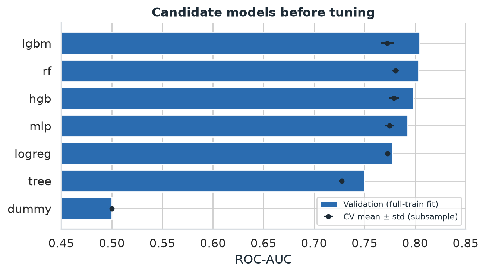

The four most flexible models are within 0.012 ROC-AUC of each other on validation. Four
different model families arriving at nearly the same score is the first sign that the limit is in the
features, not in the algorithm.

**Three design experiments**, each changing one thing with the LightGBM settings held fixed:

*Encoding the categories* (cross-validated on training data):

| Encoding | CV ROC-AUC | ± std | Model columns |
|---|---|---|---|
| ordinal (deployed) | 0.7726 | 0.0067 | 30 |
| one-hot | 0.7752 | 0.0043 | 89 |
| target encoding | 0.7776 | 0.0040 | 30 |

Ordinal codes are kept: the difference is small, and they keep the model compact and the ONNX export simple.

*Handling class imbalance* (scored on validation):

| Method | Val. ROC-AUC | Val. PR-AUC | Mean predicted | Actual rate |
|---|---|---|---|---|
| none | 0.788 | 0.611 | 0.266 | 0.275 |
| class weights | 0.788 | 0.610 | 0.382 | 0.275 |
| SMOTENC oversampling | 0.785 | 0.604 | 0.287 | 0.275 |

No resampling is used. The imbalance is moderate, neither class weights nor SMOTENC oversampling improves
the ranking, and both push the average predicted probability away from the real cancellation rate, which
would then have to be calibrated back. The decision threshold is moved instead (Section 6.3).

*More feature engineering* (cross-validated on all training rows): eight further booking-time features
(the company ID; the weekday, month and day of year of the booking date; the arrival day of year and day of
month; the total value of the stay).

| Feature set | Columns | CV ROC-AUC | ± std across folds | Gain (same folds) |
|---|---|---|---|---|
| deployed features | 30 | 0.7986 | 0.0015 | +0.0000 |
| deployed + candidate features | 38 | 0.8003 | 0.0030 | +0.0017 |

The gain is +0.0017 on average, with the folds themselves spread by 0.0015. Not
adopted: a gain that small does not justify more inputs for the API to collect. It is also the second
sign that these columns have given what they can.

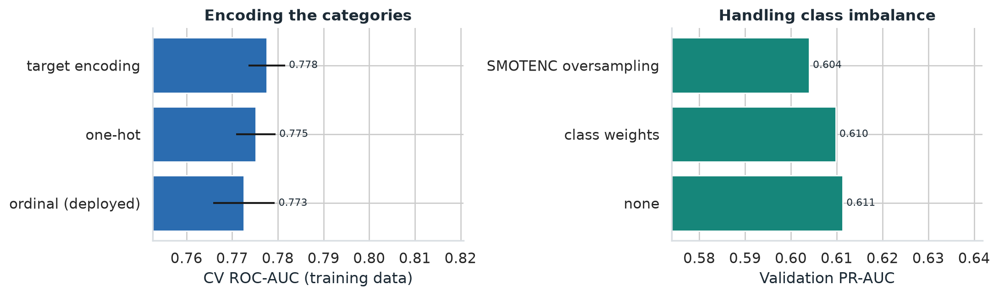

---

## 6. Model evaluation and hyperparameter tuning

### 6.1 Three search strategies, in two stages

**Stage 1: compare the strategies.** 3-fold stratified cross-validation on a stratified training
subsample of 20,000 rows, fixed trial counts and seeded samplers. Grid search on logistic
regression, random search on the random forest, and **all three strategies on LightGBM with the same
budget** so that their efficiency can be compared fairly.

**Stage 2: refine on all training rows.** The best settings for a small sample are not the best for the
full training set, because less data favours smaller, slower-learning models. A second Bayesian search
therefore runs on all 61,058 training rows. Its first trials are LightGBM's untuned settings and
the winner of each stage-1 search, so it can only match or beat them in cross-validation.

| Stage | Strategy | Model | Rows | Configurations | Fits | Best CV ROC-AUC | Seconds |
|---|---|---|---|---|---|---|---|
| 1 | grid | logreg | 20,000 | 8 | 24 | 0.7729 | 30 |
| 1 | random | rf | 20,000 | 20 | 60 | 0.7819 | 289 |
| 1 | grid | lgbm | 20,000 | 24 | 72 | 0.7835 | 190 |
| 1 | random | lgbm | 20,000 | 24 | 72 | 0.7856 | 166 |
| 1 | bayesian | lgbm | 20,000 | 24 | 72 | 0.7866 | 129 |
| 2 | bayesian, all training rows | lgbm | 61,058 | 24 | 72 | 0.8043 | 466 |

The seconds are wall-clock times of the pipeline run; the notebook's own run reports different times for
the same searches and the same scores.

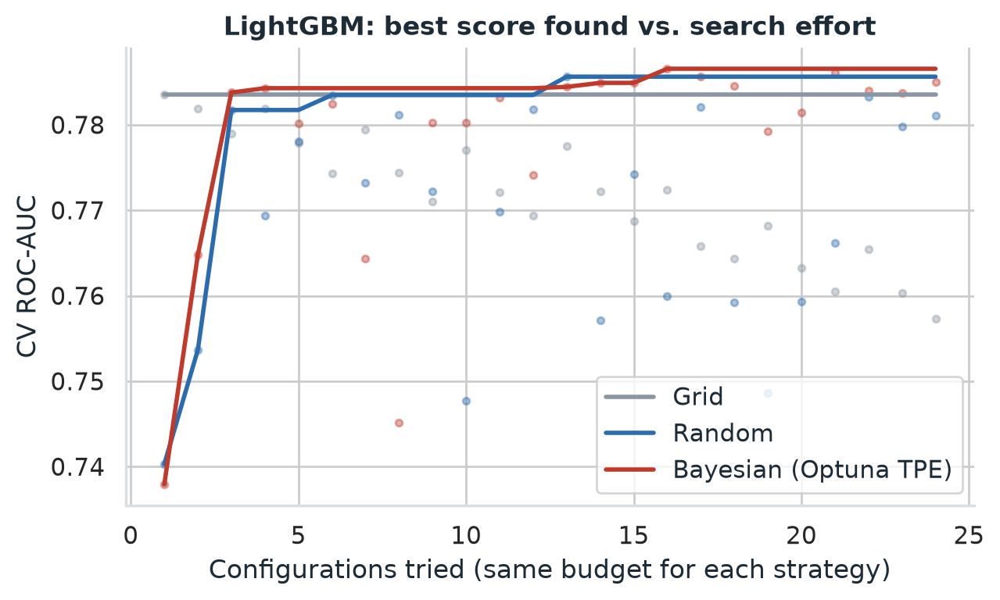

With the same budget, the best stage-1 scores were 0.7835 (grid), 0.7856 (random) and
0.7866 (Bayesian). Grid search can only find what its grid contains; random and Bayesian search
cover eight settings at the same cost, and Bayesian search uses earlier results to decide where to look
next. The differences are small, which is itself informative: the score is not sensitive to the settings.
In stage 2 the starting points scored 0.7980 (untuned settings), 0.7937 (best of grid search), 0.8017 (best of random search), 0.7984 (best of Bayesian search), and the best configuration found
0.8043 (stage-2 scores are not comparable with stage-1 scores, since each fold has more rows).

**Why two stages: a defect I found and fixed.** In the first version of this project the champion came
straight from stage 1, and on validation it scored 0.8017, *below* LightGBM with untuned
settings (0.8047). A tuned model that loses to the untuned one is a defect, whatever the test
score. Stage 2 fixes it, and the champion now scores 0.8098 on validation. Section 8.1
explains what this means for the test set.

**Choosing the champion.** The best setting of each family is refitted on all training rows and scored on
validation:

| Model | Tuned by | Validation ROC-AUC | Size (KB) |
|---|---|---|---|
| logreg | grid | 0.7767 | 11 |
| rf | random | 0.8020 | 88,321 |
| lgbm | bayesian, all training rows | 0.8098 | 9,012 |

Rule (validation data only): the best validation ROC-AUC among the tree models wins; models within
0.002 of the best are treated as tied, because a difference that small is below run-to-run
noise, and the smallest tied model wins because it deploys and scores faster. **Champion:
LightGBM, tuned by Bayesian search on all training rows**, with settings `{"num_leaves": 136, "learning_rate": 0.0199, "n_estimators": 630, "min_child_samples": 7, "subsample": 0.883, "colsample_bytree": 0.5929, "reg_lambda": 0.1408, "subsample_freq": 1}`.

### 6.2 Underfitting or overfitting

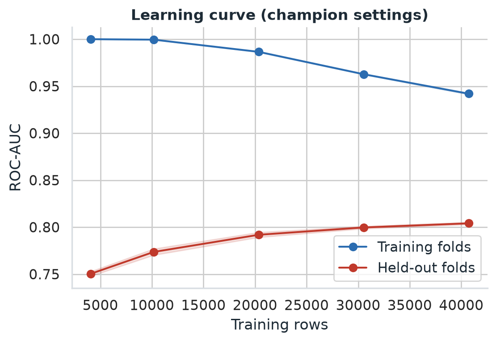

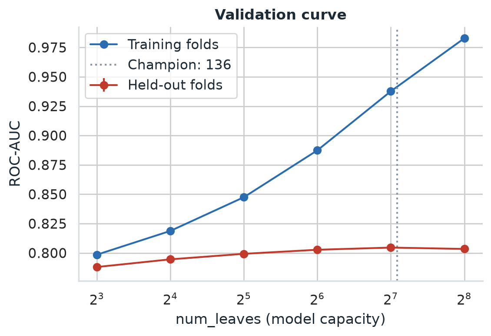

- **Learning curve.** As the training set grows, the training-fold score falls to 0.942 and the
  held-out score rises to 0.804; the last step added +0.0044. The held-out curve is still rising slowly, so more data of the same kind would help a little, but nowhere near enough to reach the target.
- **Validation curve.** With the other settings fixed and the number of leaves varied from 8 to 256 on all training rows, the training score climbs from 0.799 to 0.983, while the held-out score is highest at 128 leaves (0.8046), against 0.7880 at 8 and 0.8034 at 256. Too little capacity costs held-out score, too much only adds memorisation; the champion uses 136 leaves.
- On all training rows the champion scores 0.915 against 0.8098 on validation.

**Diagnosis.** *Overfitting: yes, of the harmless kind.* The model fits its training rows far better than
held-out rows, as any large boosted ensemble does. What matters is the held-out score, and these settings
were chosen because they maximise it in cross-validation, over a search space that includes much smaller
and more heavily regularised models; a smaller gap bought with a lower held-out score would be worse, not
better. *Underfitting: no.* A more flexible model does not do better on held-out data. The remaining error
cannot be removed with these features.

### 6.3 Calibration, the threshold and the classification metrics

**Calibration.** The hotel acts on the probability, so a predicted 30% should mean that about 30% of such
bookings cancel. Isotonic calibration was tested with out-of-fold predictions on validation: Brier score
0.1483 calibrated against 0.1478 uncalibrated. Calibration is **not needed**; the
model's own probabilities are already reliable.

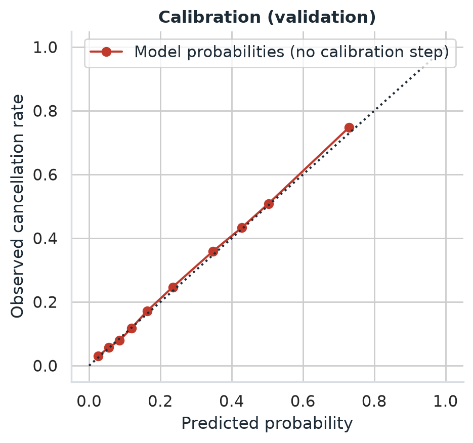

**Threshold.** The threshold that minimises the expected cost per booking on validation is
**0.63**.

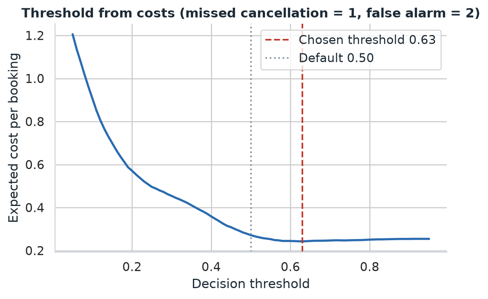

**Is the low recall a problem with the model or a consequence of the costs?** A consequence of the costs.
With calibrated probabilities, acting on a booking pays off only when its probability of cancelling
exceeds false-alarm cost / (false-alarm cost + missed-cancellation cost) = 2/3. Few bookings are that
certain to cancel, so few are flagged. The cost curve is also nearly flat around its minimum (within 0.005
per booking for every threshold from 0.57 to 0.71), which says the same thing from the other
side: at these costs, flagging single bookings saves little (11.8% on validation). I
report that plainly rather than choose a threshold that makes the metrics look better. Three operating points, all chosen on validation:

| Operating point | Threshold | Bookings flagged | Accuracy | Precision | Recall | F1 |
|---|---|---|---|---|---|---|
| cost-based (deployed) | 0.63 | 6.4% | 0.768 | 0.836 | 0.194 | 0.315 |
| default 0.5 | 0.50 | 15.1% | 0.778 | 0.675 | 0.371 | 0.478 |
| best F1 | 0.29 | 40.1% | 0.734 | 0.511 | 0.745 | 0.607 |

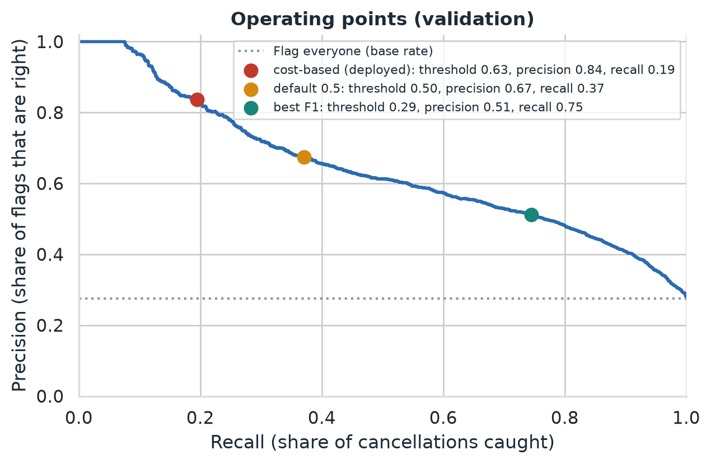

And how the decision moves when a false alarm is cheaper or dearer than relocating a guest (a missed
cancellation costs 1; for a confirmation e-mail a false alarm costs almost nothing):

| Cost of a false alarm | Threshold | Bookings flagged | Precision | Recall | Cost per booking | Without a model | Saving |
|---|---|---|---|---|---|---|---|
| 0.2 | 0.17 | 53.7% | 0.441 | 0.859 | 0.099 | 0.145 | 31.9% |
| 0.5 | 0.31 | 38.5% | 0.519 | 0.727 | 0.168 | 0.275 | 39.0% |
| 1 | 0.50 | 15.1% | 0.675 | 0.371 | 0.222 | 0.275 | 19.2% |
| 2 | 0.63 | 6.4% | 0.836 | 0.194 | 0.243 | 0.275 | 11.8% |
| 3 | 0.74 | 3.6% | 0.929 | 0.120 | 0.250 | 0.275 | 9.3% |

### 6.4 What the scores mean for the hotel

Two views that do not depend on a threshold (validation data):

Sorting bookings by predicted risk and cutting them into ten equal groups, the riskiest tenth cancels
75% of the time and the safest tenth 3%; the riskiest three tenths contain
61% of all cancellations.

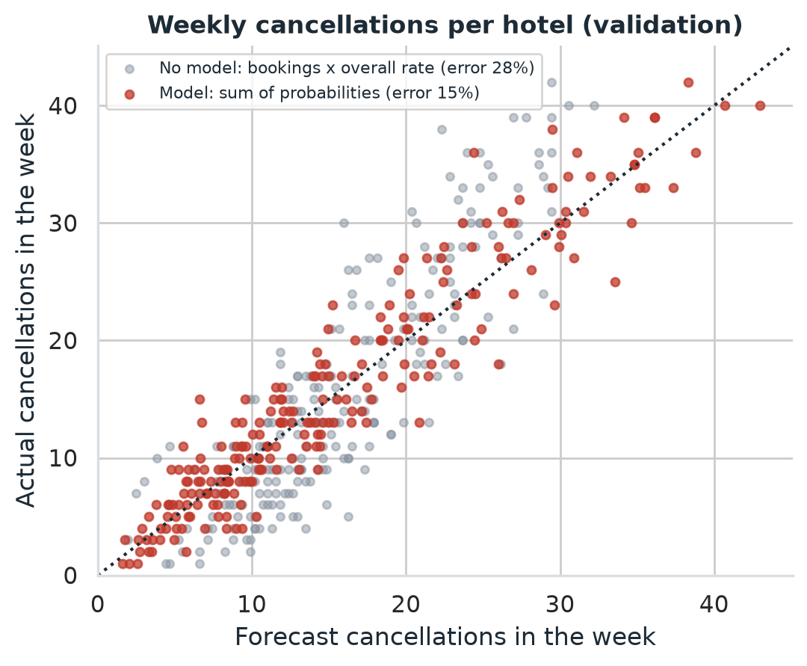

Overbooking is decided for a hotel and a period, on the expected *number* of cancellations, which is the
sum of the predicted probabilities. Per hotel and arrival week (228 hotel-weeks, a median of
53 validation bookings each), the forecast misses the actual count by
15% (summed absolute error over summed actual count), against 28% for
the forecast that needs no model (bookings times the overall cancellation rate).

### 6.5 Error analysis and explanations

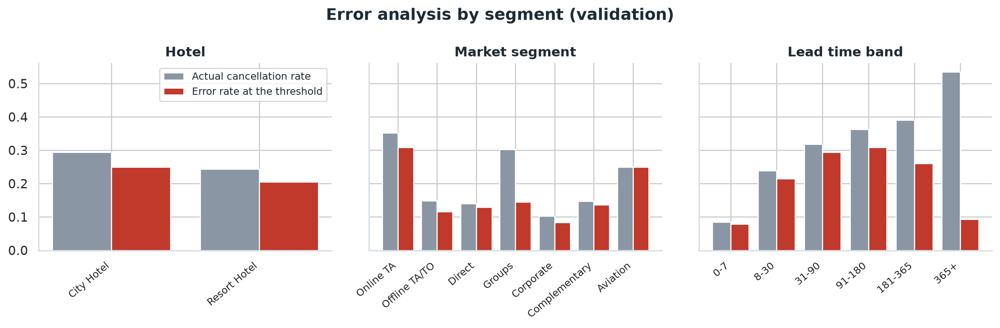

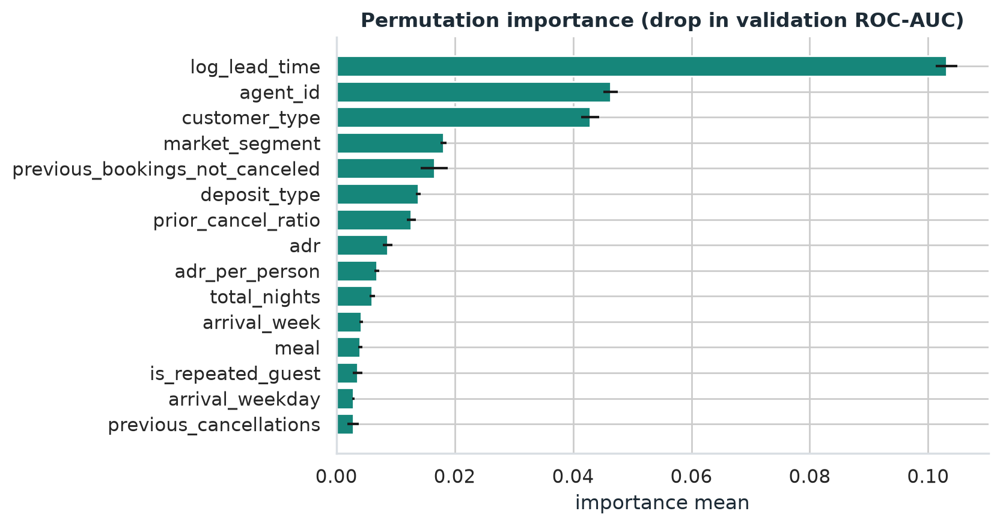

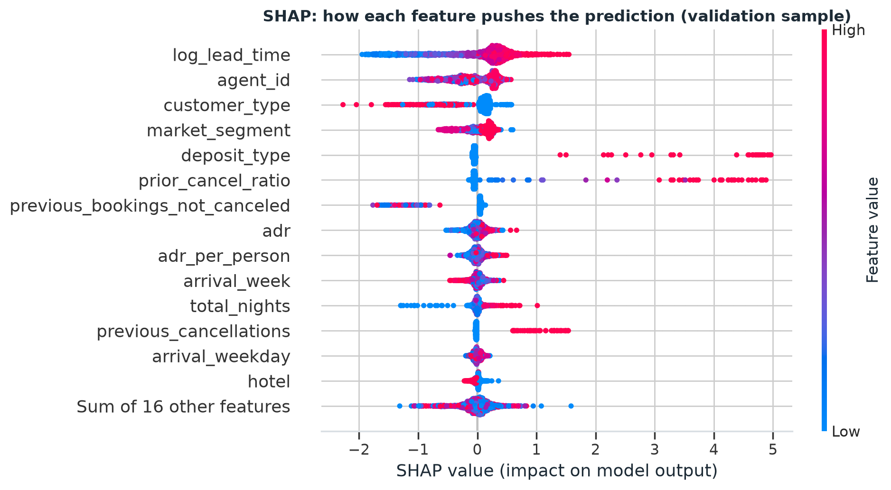

The most important features (drop in validation ROC-AUC when shuffled) are `log_lead_time`, `agent_id`, `customer_type`, `market_segment`, `previous_bookings_not_canceled`. SHAP values
show the direction for the numeric ones: long lead times and a history of cancellations push the
predicted risk up; a history of kept bookings pushes it down. For the categorical features (deposit type,
agent, customer type, market segment) the plot shows how much they matter, not a direction, because
their colour is only a code; for deposit type the direction is known from Section 3.2, where the
non-refundable bookings are the ones cancelled almost always. None of this is surprising to a hotelier,
which is reassuring: the
model has learned behaviour, not an artefact like the parking column. Among groups of at least 1,000
validation bookings, the error analysis shows it is weakest on bookings made 0-7 days before arrival (ROC-AUC 0.717, cancellation rate 9%) and the Direct segment (ROC-AUC 0.740).

### 6.6 Robustness over time

The stratified split mixes all years. Refitting the champion's settings on arrivals up to 2016 and
scoring 2017 (training and validation rows only) gives ROC-AUC **0.764**, lower
than 0.8098 on the stratified validation set. Predicting a year the model has not seen is
harder; this is a limitation and the reason for the retraining policy in Section 10.

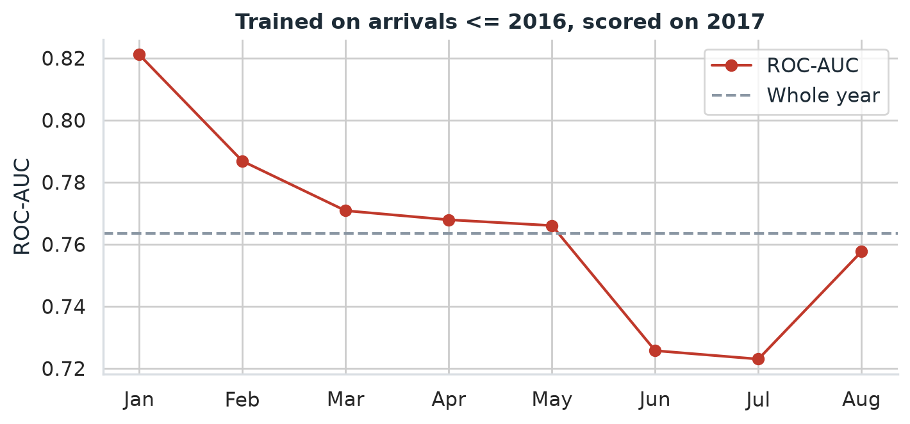

---

## 8. Model testing and deployment

### 8.1 The final evaluation on the test set

**What is scored.** Three models declared in the configuration in advance: the majority-class baseline,
the tuned logistic regression and the champion. Each uses the threshold chosen on validation.
Isotonic calibration was tested for the champion and not adopted (Section 6.3), so every model is scored on its own probabilities. The metrics are the same as in the evaluation step.

**The test set has been scored twice. This is the second time.**

| | First evaluation (2026-11-10) | Final evaluation |
|---|---|---|
| Champion | LightGBM tuned by Bayesian search on a 20,000-row training subsample | LightGBM, tuned by Bayesian search on all training rows |
| Validation ROC-AUC | 0.8017 | 0.8098 |
| Test ROC-AUC | 0.797 (95% CI 0.789 to 0.805) | 0.807 (95% CI 0.799 to 0.814) |
| Precision / recall / F1 at the cost threshold | 0.825 / 0.163 / 0.273 | 0.812 / 0.193 / 0.311 |

*What changed between the two.* Only the champion's hyperparameters. The first champion scored lower on validation than LightGBM with default settings, because settings found on a 20,000-row subsample do not transfer to the full training set. A second search stage on all training rows was added. The data, the split, the features, the leakage decisions, the costs and the success criterion are unchanged, and the change was decided on validation data before the test set was scored again.

*What that means.* A test set that has been looked at is no longer perfectly unseen: I decided to improve
the tuning after the first test result was known. The change itself was chosen on validation data and
would have been made on that evidence alone, and the second result is reported whichever way it moved.
The test score moved by +0.0095, in line with the +0.0081 that was already visible on
validation before the test set was scored again, which is what a real improvement looks like. Both
evaluations are far below the target, so the verdict does not depend on which one is used. The archived
results of the first evaluation are in `reports/metrics/history/`.

**Results.**

| Model | Test ROC-AUC | PR-AUC | Cost per booking |
|---|---|---|---|
| Majority class | 0.500 | 0.275 | 0.275 |
| Logistic regression (tuned) | 0.774 | 0.592 | 0.254 |
| **Champion** | **0.807** (95% CI 0.799 to 0.814) | **0.636** | **0.247** |

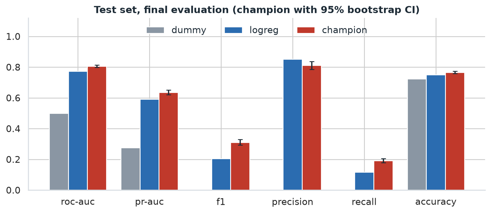

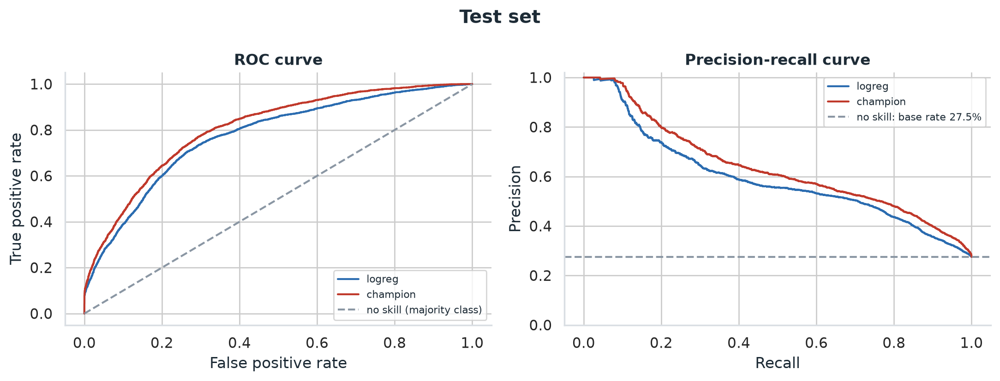

The majority-class baseline gives every booking the same score, so it has no curve of its own: it is the dashed no-skill line in both panels (the diagonal for ROC, the base rate of 27.5% for precision-recall).

The champion at the three operating points (thresholds from validation), with accuracy, precision, recall
and F1:

| Operating point | Threshold | Bookings flagged | Accuracy | Precision | Recall | F1 |
|---|---|---|---|---|---|---|
| cost-based (deployed) | 0.63 | 6.5% | 0.766 | 0.812 | 0.193 | 0.311 |
| default 0.5 | 0.50 | 15.1% | 0.773 | 0.661 | 0.362 | 0.467 |
| best F1 | 0.29 | 40.5% | 0.731 | 0.507 | 0.746 | 0.604 |

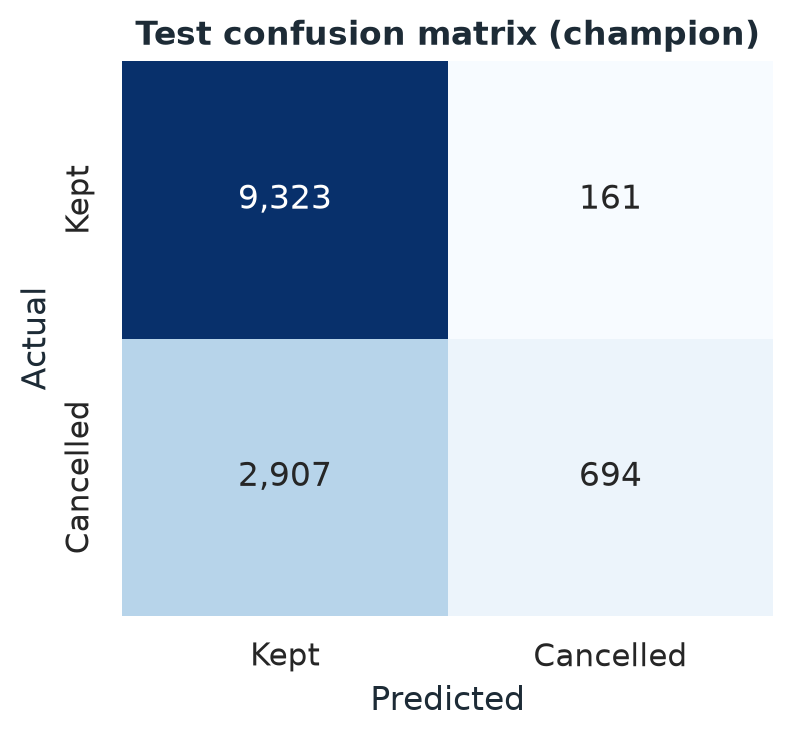

Brier score 0.1487. Cost sensitivity on the test set:

| Cost of a false alarm | Threshold | Bookings flagged | Precision | Recall | Cost per booking | Without a model | Saving |
|---|---|---|---|---|---|---|---|
| 0.2 | 0.17 | 53.7% | 0.440 | 0.859 | 0.099 | 0.145 | 31.7% |
| 0.5 | 0.31 | 38.9% | 0.516 | 0.728 | 0.169 | 0.275 | 38.6% |
| 1 | 0.50 | 15.1% | 0.661 | 0.362 | 0.227 | 0.275 | 17.6% |
| 2 | 0.63 | 6.5% | 0.812 | 0.193 | 0.247 | 0.275 | 10.3% |
| 3 | 0.74 | 3.9% | 0.906 | 0.128 | 0.251 | 0.275 | 8.8% |

For the hotel's two uses:

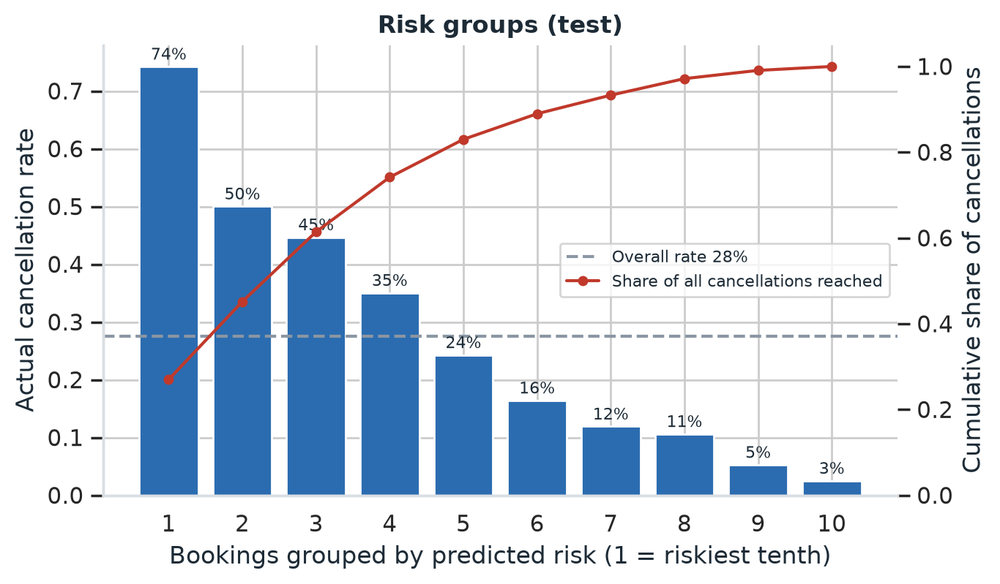

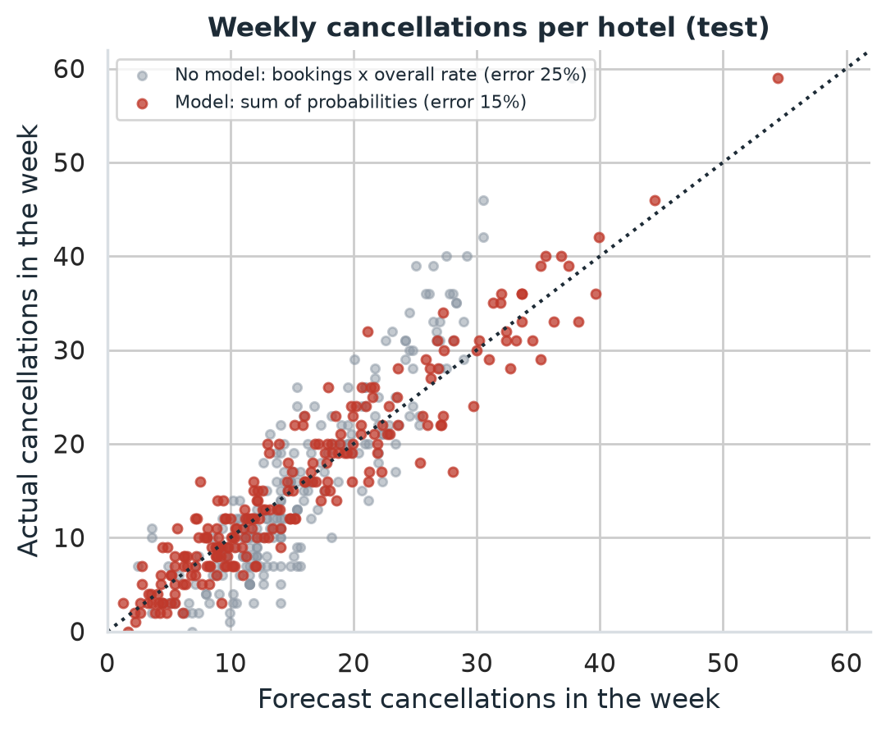

- The riskiest tenth of test bookings cancels 74% of the time and the safest tenth
  3%; the riskiest three tenths contain 61% of all cancellations.
- Cancellations per hotel and week are forecast with an error of 15%, against
  25% without the model; the total over all weeks is off by -1.2%.

**Verdict against the criteria of Section 1.**

- Beats both baselines: **yes**.
- Test ROC-AUC of at least 0.85: **not met**.
- Calibrated probabilities: **met**, without a separate calibration step. The test Brier score is 0.1487, against 0.1995 for a model that gives every booking the base rate; summed over all test bookings the model predicts 3,559 cancellations against 3,601 actual (-1.2%); and isotonic calibration did not improve the out-of-fold Brier score on validation (0.1483 against 0.1478 without it).

**Why the target was missed.** The target was set before modelling and I have not moved it. The evidence
for why it is out of reach with these columns:

1. *Scores above 0.85 on this data come from information that does not exist at booking time.*
   Adding the columns recorded later lifts validation ROC-AUC from 0.805 to 0.920
   (Section 3.6).
2. *Or from counting easy rows many times.* With duplicates kept and no memorisation possible the score is
   0.858; counting each distinct record once it is 0.800 (Section 3.7).
3. *Better modelling does not close the gap.* Four model families are within 0.012 of each
   other; eight more features add +0.0017; two stages of tuning moved the champion from
   0.8047 to 0.8098 on validation; the last quarter of the training data added
   +0.0044 to the held-out score (Sections 5 and 6).

Reaching the target honestly would need new information available at booking time, such as a guest's
history under a real guest ID, the payment method, or the channel's own cancellation terms. In hindsight
the target was too high for a booking-time model on this data. That is a finding of the project, and the
criterion stays as written.

### 8.2 Deployment

**Export.** The champion is converted to ONNX, a portable format that needs only the small `onnxruntime`
library, with a metadata file holding the feature order, category codes, calibration, threshold and test
metrics. The ONNX model is 6,511 KB. *Alternative considered:* shipping the scikit-learn pipeline as
a pickle, rejected because it would pull pandas, scikit-learn and LightGBM into the serverless bundle and
tie the service to exact library versions.

**Parity.** On 200 validation bookings, the exported path (shared feature code, category codes, ONNX
model, calibration) matches the scikit-learn pipeline to within 1.3e-07 (limit 0.0001). A test repeats
the check through the API's own request schema.

**Service.** A FastAPI application (`service/`). It is deployed on Vercel's free tier: [https://hotel-cancellation-risk.vercel.app](https://hotel-cancellation-risk.vercel.app).

| Endpoint | Purpose |
|---|---|
| `GET /` | Demo page: fill in a booking, see its risk |
| `GET /docs` | Interactive API documentation |
| `GET /health` | Liveness and model version |
| `GET /api/v1/model` | Model card: features, threshold, test metrics, excluded columns |
| `POST /api/v1/predict` | One booking in; probability, decision and risk band out |
| `POST /api/v1/predict/batch` | Up to 100 bookings |
| `POST /api/v1/feedback` | Report the real outcome of an earlier prediction |
| `GET /api/v1/feedback/summary` | How the predictions compare with the outcomes reported so far |
| `GET /api/v1/metrics` | Request counts and latency for the serving instance |

Requests are validated: values outside plausible ranges, unknown fields and malformed input are rejected
with a readable message rather than scored. Categories the model has never seen (a new travel agent, for
example) are scored as "unknown" and reported back in the response.

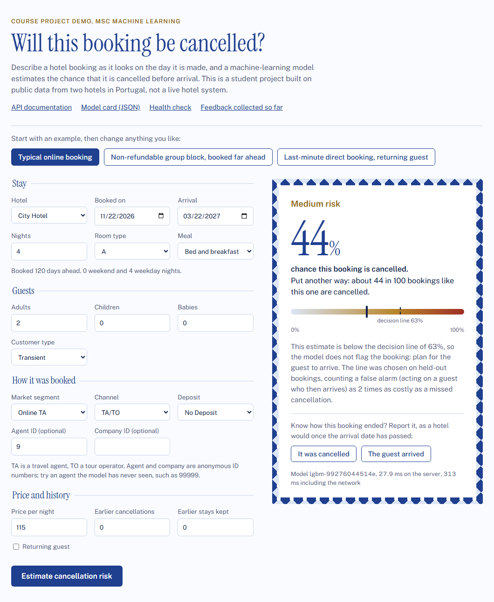

**Integration with an existing system.** A hotel's booking system calls `POST /api/v1/predict` when a
booking is created, stores the returned probability and `prediction_id` next to the reservation, and
reports the real outcome to `/api/v1/feedback` after the arrival date. The demo page is itself such a
client, and the notebook contains another in plain Python (Sections 8.3 and 10.4 of the notebook).

*Alternatives considered:* Streamlit (simpler to build, but an application rather than an API that another
system can call); a container on Render or Hugging Face Spaces (fine, but slower cold starts on free tiers
and more to maintain).

---

## 10. Monitoring and maintenance

**Latency and errors.** 300 real validation bookings were replayed one at a time against the deployed service (`https://hotel-cancellation-risk.vercel.app/api/v1/predict`): the first request took 582 ms, then the median was 520 ms, the 95th percentile 978 ms and the 99th 1,171 ms, measured from the client; the error rate was 0.0%. The server's own processing time had a median of 1.8 ms; the rest is network and platform overhead. The instance was already running when the replay began, so the first request is not a cold start and takes about as long as the rest. A cold start was measured separately: after the service had been left without traffic, one request took 4.0 s (GET /health, timed from the client, 22 November 2026). These figures come from the pipeline's monitoring command. The notebook repeats the replay in its own run with fewer bookings, so the latency figures in its saved output differ from these; both are measurements of the same service.

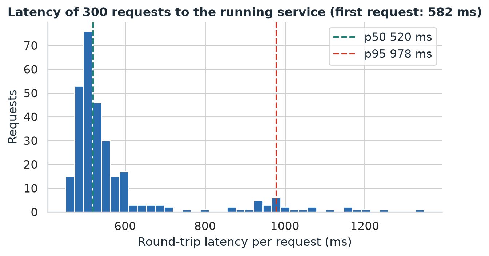

**Does the running service give the model's answers?** Yes. Over the same 300 bookings, the largest difference between the service's answer and the exported model run offline was 6.8e-07 (the service rounds to six decimals). The service reports model version `lgbm-99276044514e`, which is the fingerprint of the model file the pipeline exported.

**Data drift.** Comparing arrivals up to 2016 with 2017 for every deployed feature (population stability index, PSI), 4 of 30 features shift by more than 0.25: `month_sin`, `arrival_week`, `month_cos`, `agent_id`. The largest is `month_sin` (PSI 5.19). Calendar features shift by construction, because the data covers July
2015 to August 2017 and the two periods contain different months; shifts in how bookings are sold
(segment, agent, price) are the ones to watch.

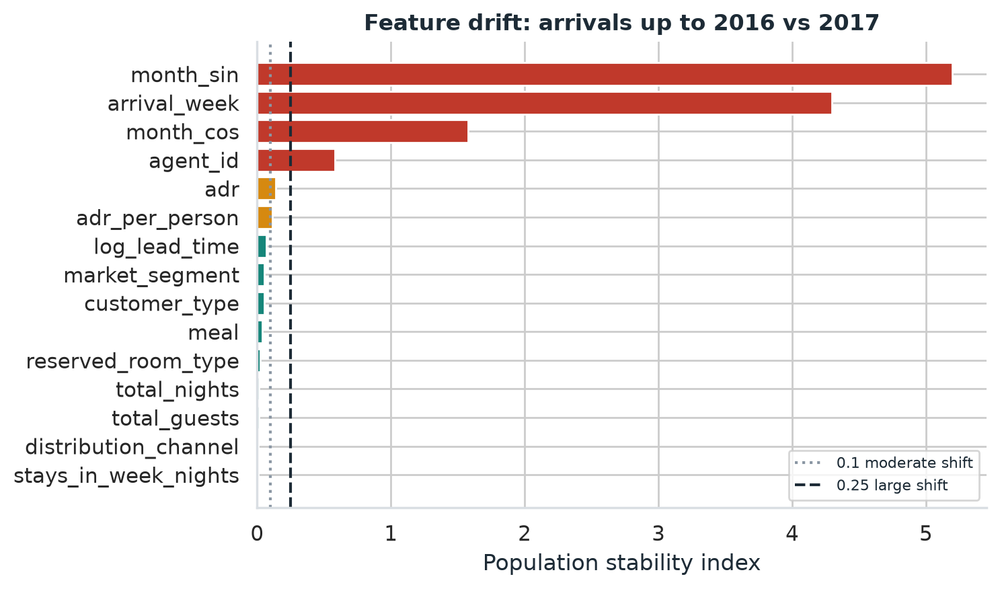

**Performance over time.** Section 6.6: ROC-AUC 0.764 on the following year, between
0.723 and 0.821 month by month.

**Collecting feedback.** Every prediction returns a `prediction_id`. When the arrival date has passed, the
hotel's system posts the real outcome to `POST /api/v1/feedback`; `GET /api/v1/feedback/summary` reports
how the predictions compare with the outcomes received so far. On the free serverless tier feedback is kept in the memory of the running instance and written to the logs; it is lost when the instance is recycled. A hosted database is supported by the service and is the next step. The notebook
demonstrates the loop against the running service with validation bookings whose outcomes are known.

**Retraining policy.**

| Signal | How it is measured | Action |
|---|---|---|
| Performance drop | Monthly ROC-AUC on bookings whose outcome is now known, from the feedback data | Retrain if it is more than 0.03 below the validation ROC-AUC for two months in a row |
| Input drift | Monthly PSI of every feature against the training data | Investigate any PSI above 0.25; retrain if three or more booking-channel or price features exceed it |
| Calibration | Mean predicted probability against the actual cancellation rate each month | Re-fit the calibration (cheap, no retraining) if they differ by more than 5 percentage points |
| Schedule | Calendar | Retrain at least every six months on the latest 24 months, so every season is represented |
| Service health | 95th-percentile latency and error rate from the logs | Alert if the 95th percentile exceeds 1 s or errors exceed 1% |

Applied to the replay above: the 95th percentile was 978 ms, just under the 1 s line, and the error rate was 0.0%. Nearly all of that time is network and platform overhead (the server's own median is 1.8 ms), so the limit says more about the free hosting tier than about the model. The figure moves from one replay to the next, and the notebook's own replay is reported in the notebook.

Retraining means re-running the pipeline on newer data: champion, calibration and threshold are
re-chosen, the parity check must pass, and the new model replaces the old one only if it is at least as
good on the newest validation period.

---

## 11. Documentation and reporting

#### What was submitted and where it is

| Deliverable | In the submission folder | In the repository (`4_Source_Code.zip`) |
|---|---|---|
| Working code (the notebook, executed with full budgets) | `1_Code_Notebook.ipynb` | `notebooks/01_hotel_cancellation_classification.ipynb` |
| Process documentation (this document) | `2_Process_Documentation.pdf` and `.docx` | `docs/PROCESS.pdf`, `docs/PROCESS.docx`; Markdown source `docs/PROCESS.md` |
| Presentation | `3_Presentation.pptx` | Not in the repository; the slides are built from the same results files by a separate script |
| Source code and supporting documents | `4_Source_Code.zip` | `README.md`, `docs/MODEL_CARD.md`, `docs/ARCHITECTURE.md`, the package in `src/`, the API in `service/`, the tests |
| Deployed endpoint | [https://hotel-cancellation-risk.vercel.app](https://hotel-cancellation-risk.vercel.app) | `service.url` in `configs/config.yaml` |

#### Reproducibility

- **Same code everywhere.** The project is a tested Python package; the notebook is built from it by a
  script that copies the package's functions in verbatim, so the notebook is self-contained while
  executing exactly the tested code. It was run alone in an empty folder, which is what a Colab or
  Jupyter upload amounts to; it was not run on Colab itself. A test checks that the notebook
  and the pipeline used the same test rows and reached the same test metrics.
- **Fixed inputs.** One random seed, exact package versions, and a checksummed data file.
- **Checks.** 71 automated test functions (more test cases, since several run over many inputs): cleaning rules, features, metrics and the analyses in this
  document; the API with valid and invalid input; that the service's feature code and model files are
  identical to the pipeline's; and that the service reproduces the pipeline's predictions.
- **One source of numbers.** The pipeline writes its results to `reports/metrics/`; this document, the
  README, the model card and the slides are generated from those files. The notebook computes its own
  copy of every result; model metrics and data counts match the pipeline's, while run times and latency
  were measured separately in each run.

#### Limitations

- Two hotels, one country, 2015 to 2017. Performance elsewhere is unknown, and on a year the model has
  not seen the score is lower (0.764).
- The target ROC-AUC was not met. The model ranks bookings usefully and forecasts weekly counts well, but
  at the stated costs its single-booking flags save little.
- Columns whose timing could not be established were excluded. That costs accuracy and makes the score
  honest; with better knowledge of the hotels' systems some could return.
- Duplicates were removed although many are probably genuine block bookings (Section 3.7).
- The cost figures are assumptions.
- The test set was scored twice (Section 8.1).
- Exact duplicates were removed on all 32 columns, so bookings that differ only in a column the model does not use can still sit on both sides of the split with identical model inputs: 1,156 of the 13,085 test rows (8.8%) and 1,223 validation rows (9.3%) share all 22 booking-time inputs with a training row. The grouped experiment in Section 3.7 (0.800 with such rows kept on one side, against 0.805 without that precaution) suggests an effect on ROC-AUC of about 0.005.
- The split is random rather than by time, so the headline score is somewhat optimistic for real use.
- The "Non Refund" label behaves like a recording practice; the model learns it as recorded.

#### What I would do next

1. Obtain a guest identifier and booking timestamps, to build real history features and evaluate strictly
   forward in time.
2. Treat a block booking as one decision with a room count instead of many identical rows.
3. Confirm with the hotels when each excluded column is recorded, and add back those known at booking.
4. Evaluate overbooking policies by simulation on held-out weeks instead of through one cost ratio.
5. Automate the monthly monitoring report and the retraining rule.

#### References

- Antonio, N., de Almeida, A. and Nunes, L. (2019). Hotel booking demand datasets. *Data in Brief*, 22,
  41-49. https://doi.org/10.1016/j.dib.2018.11.126. Licence: CC BY 4.0.
- Data file: TidyTuesday, 2020-02-11, `hotels.csv` (R for Data Science community).
- Software: scikit-learn, LightGBM, Optuna, SHAP, imbalanced-learn, ONNX Runtime, FastAPI.

---

## Appendix: decision log

| # | Decision | Alternatives | Why | Evidence |
|---|---|---|---|---|
| 1 | Predict at booking time | Predict shortly before arrival | That is when the hotel can act | Section 1 |
| 2 | ROC-AUC as the main criterion, target 0.85 | Accuracy, F1 | Independent of threshold and costs | Section 1 |
| 3 | Remove exact duplicates before splitting | Keep them with a grouped split | Cautious reading without a booking ID | 3.3, 3.7 |
| 4 | Remove only impossible values | Delete or cap statistical outliers | Rare values are real and matter | 3.3 |
| 5 | Missing agent and company become features | Imputation | "None" is information | 3.3 |
| 6 | Split before any target analysis | Explore first, split later | Keeps the test rows out of the exploration and the modelling choices; the one decision taken after a test score is set out in 8.1 | 3.1, 8.1 |
| 7 | Exclude parking, special requests, country, post-booking columns | Keep them | Not known at booking, or timing not established; "when in doubt, exclude" | 3.6 |
| 8 | Keep price | Exclude it | Agreed at booking; smooth relationship | 3.6 |
| 9 | Ordinal codes for trees | One-hot, target encoding | Within 0.005 ROC-AUC; smaller, simpler to export | 5 |
| 10 | No resampling | Class weights, SMOTENC | No ranking gain; distorts probabilities | 5 |
| 11 | Do not add eight more features | Add them | Gain of +0.0017 is within fold noise | 5 |
| 12 | Two-stage tuning | Tune only on a subsample | Subsample settings lost to the untuned model | 6.1 |
| 13 | LightGBM over the random forest | Random forest | Higher validation ROC-AUC (0.8098 against 0.8020, more than the tie tolerance of 0.002) and a model file about 10 times smaller | 6.1 |
| 14 | No calibration step | Isotonic calibration | No improvement in out-of-fold Brier score | 6.3 |
| 15 | Threshold from costs (0.63) | 0.5, best F1 | Follows from the stated costs; others reported | 6.3 |
| 16 | Keep the criterion after missing it | Lower the target | A target moved after the result means nothing | 8.1 |
| 17 | ONNX model behind FastAPI on Vercel | Pickle; Streamlit; containers | Small bundle, real API, free tier | 8.2 |
